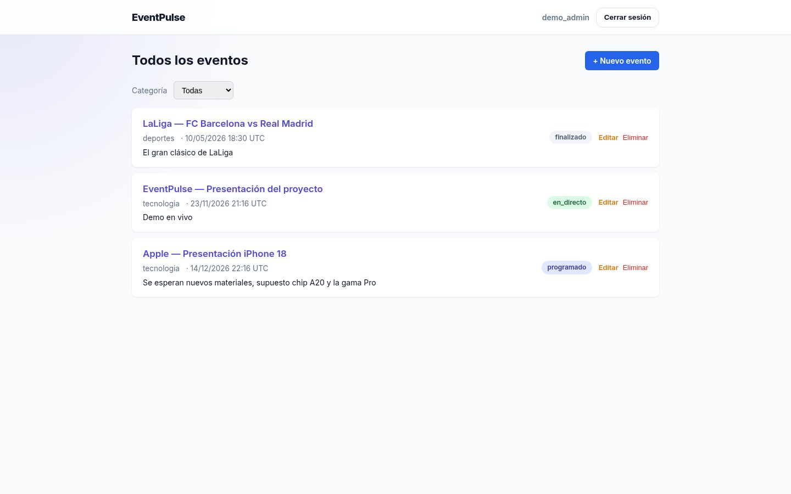
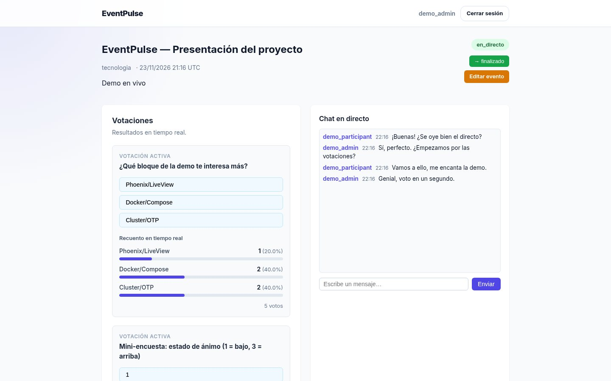
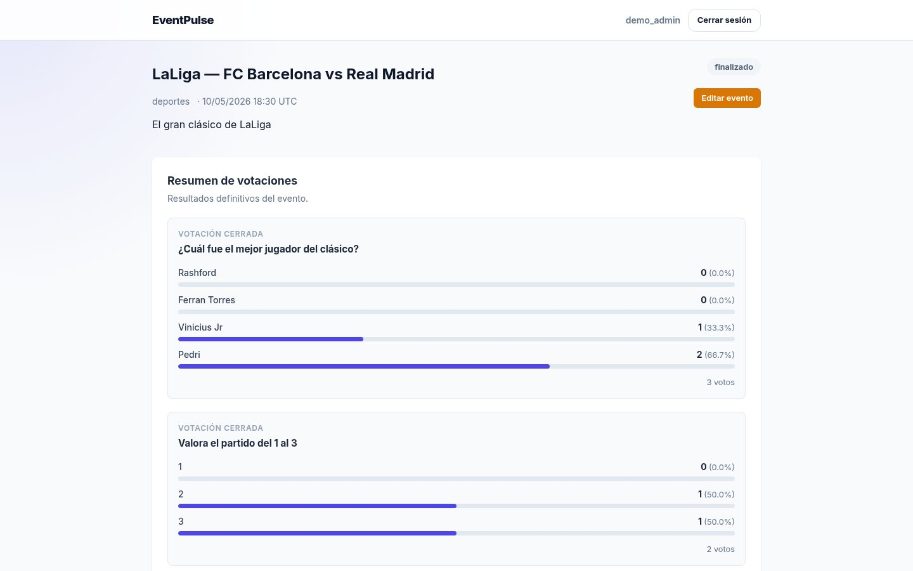
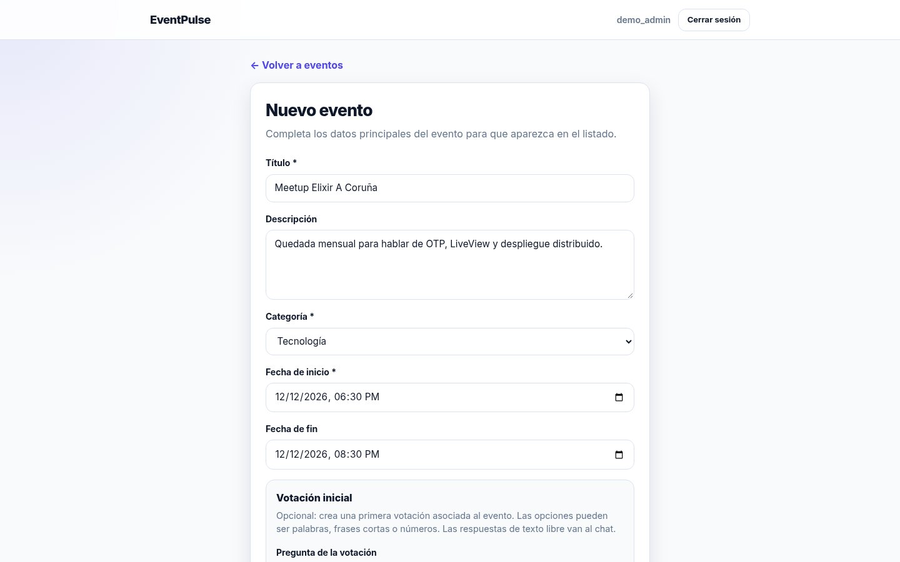
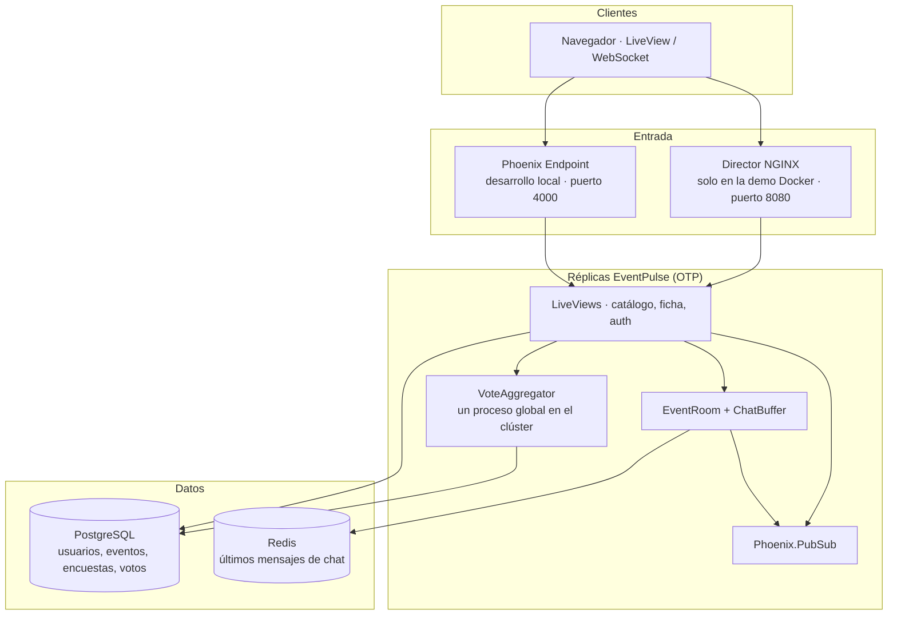

# EventPulse

**Chat y votaciones en directo para eventos reales.**

Plataforma en tiempo real para seguir un evento, votar mientras está en marcha y ver el recuento al cerrarlo. Práctica grupal de Arquitectura del Software (AS) en la Facultad de Informática (FIC) de la Universidade da Coruña, curso 2025/26.

[](https://elixir-lang.org/)
[](https://www.phoenixframework.org/)
[](https://www.postgresql.org/)
[](https://redis.io/)
[](https://github.com/pablojhdcoder/EventPulse/blob/main/docker-compose.yml)
[](LICENSE)

## 📌 Sobre el proyecto

EventPulse es una aplicación web en la que un usuario registrado consulta un catálogo de eventos, entra en la sala mientras el evento está **en directo** y participa con **encuestas en vivo** y un **chat** por evento. Al pasar el evento a **finalizado**, las encuestas se cierran, el chat deja de aceptar mensajes y la ficha muestra un **resumen de votaciones** leído de la base de datos.

Está construida con **Elixir/OTP** y **Phoenix LiveView**: la interfaz se actualiza sola por WebSocket y PubSub, sin una API REST pública de catálogo. En la demo distribuida, varias réplicas de la aplicación se agrupan en un clúster OTP detrás de un proxy NGINX, con PostgreSQL como fuente de verdad y Redis para el buffer reciente del chat.

### 🎯 Objetivos

- Cubrir el ciclo de un evento en tres estados (`programado` → `en_directo` → `finalizado`) con transiciones estrictas.
- Difundir votos y mensajes a todos los clientes conectados con baja latencia percibida (LiveView + PubSub).
- Agregar los votos en un único proceso OTP del clúster (`VoteAggregator`) y persistirlos en PostgreSQL por micro-lotes.
- Demostrar un despliegue multi-nodo (tres réplicas, Director NGINX, Redis compartido y libcluster) además del modo de desarrollo con una sola instancia.

## 🎥 Demo


https://github.com/user-attachments/assets/796e51a5-6b82-455a-979b-f7901e69ea75


## 📸 Capturas

| | |
|:---:|:---:|
|  |  |
| **Listado de eventos** | **Votación y chat en directo** |
|  |  |
| **Resumen al cerrar el evento** | **Alta de evento (administrador)** |

## ✨ Funcionalidades

- **Cuentas y roles.** Registro, inicio y cierre de sesión. Las contraseñas se guardan con Pbkdf2. Hay dos roles: *participante* (consultar, votar y chatear) y *administrador* (además, gestionar el catálogo y el ciclo de vida del evento). Las rutas principales exigen sesión.
- **Catálogo de eventos.** Listado en `/` y `/events`, con filtro por categoría (deportes, música, política, cultura, tecnología) y refresco en tiempo real cuando alguien crea, edita, borra o cambia el estado de un evento.
- **Estados.** Cada evento está `programado`, `en_directo` o `finalizado`. El administrador avanza de uno a otro desde la ficha. Al finalizar, las encuestas pasan a cerradas en base de datos y se vacía, en la medida de lo posible, el buffer de chat en Redis.
- **Encuestas en vivo.** Un evento puede tener varias encuestas, cada una con una pregunta y entre 2 y 4 opciones. Solo se vota con el evento en directo. Hay un voto vigente por participante y encuesta, y se puede cambiar. El recuento se actualiza en la interfaz con barras de porcentaje.
- **Chat por evento.** Sala asociada al evento, activa solo en directo. Al entrar se recuperan los últimos 15 mensajes (Redis Streams). Cada mensaje tiene un máximo de 500 caracteres.
- **Resumen al cierre.** En un evento finalizado la ficha muestra el recap de cada encuesta (recuentos definitivos). No hay un indicador agregado tipo «Social Feeling».
- **Administración.** El administrador crea y edita eventos (título, descripción, categoría, fechas y estado), puede añadir encuestas en directo y, si el evento sigue programado, ajustar las que ya existan.

## 🛠️ Tecnologías

| Capa | Tecnología |
|---|---|
| Lenguaje y VM | Elixir (`~> 1.14`) · Erlang/OTP |
| Web | Phoenix 1.8 · Phoenix LiveView · Bandit |
| Tiempo real | Phoenix.PubSub (adaptador PG2) |
| Dominio OTP | `VoteAggregator` (GenServer global) · `EventPulse.Chat.EventRoom` |
| Persistencia | PostgreSQL · Ecto · Postgrex |
| Buffer de chat | Redis 7 · Redix · Redis Streams |
| Autenticación | Sesión en cookie firmada · Pbkdf2 |
| Clúster (demo) | libcluster (EPMD) · DNSCluster (opcional) · NGINX como Director |
| Observabilidad | Telemetry · Phoenix LiveDashboard (solo en desarrollo) |
| Despliegue demo | Docker Compose · imagen de release (`mix release`) |

La interfaz no usa un bundler de assets: el CSS va en el layout y los scripts de Phoenix/LiveView se sirven desde las dependencias Hex.

## 🏛️ Arquitectura



En desarrollo hay una sola instancia Mix. En la demo de `docker-compose.yml` el Director reparte HTTP y WebSocket entre `web1`, `web2` y `web3`; solo `web1` arranca el agregador de votos, y las tres réplicas se descubren con `CLUSTER_PEER_HOSTS`. Los datos de negocio viven en PostgreSQL; Redis no sustituye esa persistencia (el historial del chat no se guarda en la base).

El detalle de módulos, C4 y decisiones está en [`doc/README.md`](doc/README.md).

## 📂 Estructura del repositorio

```
EventPulse/
├── docker-compose.yml          # Demo distribuida: Postgres, Redis, 3 réplicas, NGINX
├── director/nginx-director.conf
├── doc/                        # Arquitectura, ADR, C4, propuesta, capturas
├── event_pulse/                # Aplicación Phoenix
│   ├── config/                 # dev, test, prod y runtime (variables de entorno)
│   ├── lib/event_pulse/        # Dominio: accounts, events, votes, chat
│   ├── lib/event_pulse_web/    # LiveViews, plugs, router, layouts
│   ├── priv/repo/              # Migraciones y seeds de demo
│   ├── test/                   # Tests de dominio y LiveView
│   ├── Dockerfile              # Release de producción para Compose
│   └── mix.exs
└── proyecto.md                 # Integrantes del equipo
```

## 🚀 Puesta en marcha

Hacen falta **Elixir 1.14+**, **PostgreSQL** y **Redis**. La guía detallada para macOS está pensada para un MacBook Pro con Homebrew; aquí van los dos arranques habituales.

### Demo con Docker Compose

Desde la **raíz del repositorio**, con Docker Desktop en marcha:

```bash
docker compose up -d --build
```

Abre **http://localhost:8080**. La primera vez tarda en construir la imagen. Este modo publica también el puerto 5432: no lo combines con un PostgreSQL local en el mismo puerto.

### Desarrollo local

Con PostgreSQL en `localhost:5432` (usuario y contraseña `postgres`) y Redis en `localhost:6379`:

```bash
cd event_pulse
mix setup
mix phx.server
```

Abre **http://localhost:4000**. `mix setup` instala dependencias, crea la base `event_pulse_dev`, migra y carga los seeds. Para dejar los datos otra vez como el primer día: `mix ecto.reset`.

### Cuentas de demo

Tras los seeds, todas las cuentas usan la contraseña `Admin!1demo`:

| Email | Rol |
|---|---|
| `admin@eventpulse.local` | administrador |
| `participant@eventpulse.local` | participante |
| `paco@eventpulse.local` | participante |
| `manolo@eventpulse.local` | participante |

Hay tres eventos de ejemplo: uno programado (keynote), uno en directo (presentación de EventPulse, con encuestas y votos) y uno finalizado (el clásico, con resumen de votaciones).

Un detalle útil al probar: los votos se asocian a un identificador entero de sesión, no al UUID de la cuenta. Para ver dos votos distintos, usa una ventana privada o otro navegador.

## 🧪 Tests

Desde `event_pulse/`, con PostgreSQL y Redis en marcha:

```bash
mix test
```

La suite cubre autenticación, el ciclo de vida de los eventos, el agregador de votos y las LiveViews del catálogo y la ficha (**80 tests**). El alias `mix test.docker` levanta un PostgreSQL de prueba en el puerto 5433, pero no arranca Redis: ese servicio tiene que estar ya disponible en `localhost:6379`.

## 👥 Autores

Práctica grupal (equipo rikiri), Facultad de Informática (FIC), Universidade da Coruña:

- Pablo Jesús Herrero Díaz
- Tiago da Costa Teixeira Veloso e Volta
- Pablo Pérez Noceda
- Sara Salgueiro Rendo
- André Bóveda Tosar
- Miryam Raquel Sánchez Torre

## 📄 Licencia

Este proyecto se distribuye bajo la licencia [MIT](LICENSE). Copyright © 2026 Pablo Jesús Herrero Díaz.
