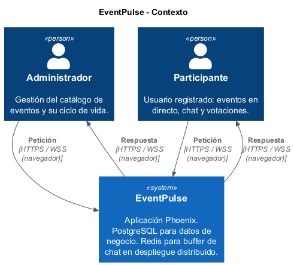
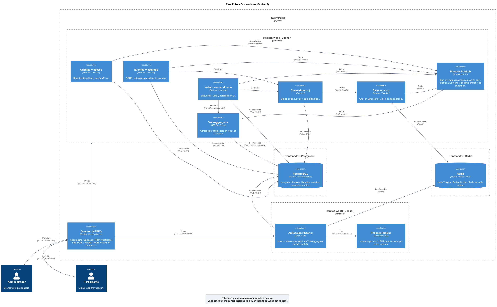

# Índice de documentación - EventPulse

Este índice centraliza la documentación vigente del proyecto.

## Documentos disponibles

- `adr.md`: registro de decisiones de arquitectura (ADR) alineado con la implementación vigente de EventPulse.
- `propuesta.md`: propuesta del proyecto **incluye RF/RNF detallados** y vistas C4.
- `arquitectura.md`: diseño de arquitectura (módulos OTP/LiveView, despliegue distribuido, Redis, Director, persistencia y límites de consistencia).
- `c4-contexto-contenedores.md`: vistas C4 **contexto** y **contenedores** con figuras PNG y guía de lectura.
- `documentacion_OTP_cluster_observabilidad.md`: observabilidad del clúster OTP y buenas prácticas de inspección.
- `../event_pulse/README.md`: **única fuente** de instrucciones para arrancar la app (local, Docker, tests) y configuración operativa básica.
- `../proyecto.md`: integrantes del equipo.
- `../presentacion.pdf`: material audiovisual adicional para la presentacion

## Diagramas C4 (PNG)

Las figuras están en **`doc/diagramas/`**: `contexto-c4.png`, `contenedores-c4.png`. Descripción y convenciones: [`c4-contexto-contenedores.md`](c4-contexto-contenedores.md).

## Estado funcional actual (resumen)

En `event_pulse/` se dispone de:

- interfaz LiveView para listado y detalle de eventos;
- chat en tiempo real por evento;
- buffer reciente de chat respaldado en Redis;
- votación en vivo con recuento actualizado;
- gestión de estado de evento (`programado`, `en_directo`, `finalizado`);
- **cierre de evento**: encuestas pasan a cerradas, sin votos posteriores; vaciado best-effort del buffer de chat en Redis;
- **resumen de votaciones** en el detalle del evento finalizado (LiveView), sin indicador agregado tipo Social Feeling persistido;
- ejecución local y demo distribuida: ver [`../event_pulse/README.md`](../event_pulse/README.md).
