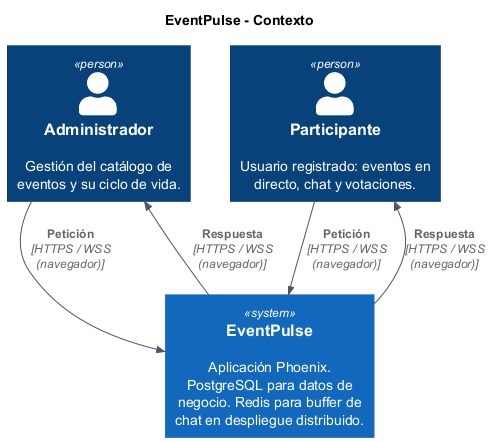
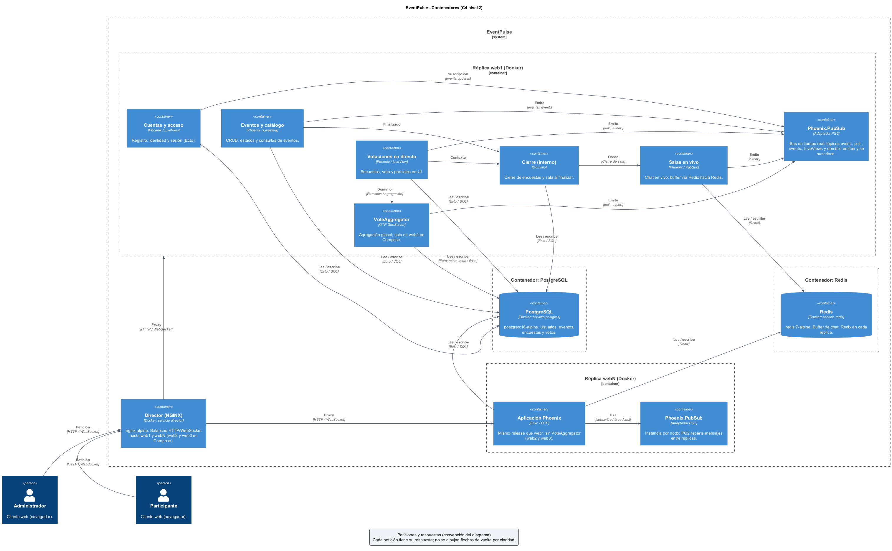

# EventPulse — Diagramas C4 (contexto y contenedor)

Este documento presenta las vistas **C4 nivel 1 (contexto)** y **C4 nivel 2 (contenedores)** del modelo C4, elaboradas con la biblioteca **C4-PlantUML** y exportadas a **PNG** en [`./diagramas/`](./diagramas/) para incrustar en Markdown.

A grandes rasgos la arquitectura se alinea con *cliente–servidor distribuido*: servicios relativamente independientes, **cliente ligero** (navegador + LiveView), **directorio intermedio** (entrada única que reparte carga) y persistencia compartida.

## Relación con el estilo cliente–servidor distribuido

| Aspecto | Cómo se refleja en EventPulse |
|--------------------------|-------------------------------|
| Funcionalidades como servicios relativamente independientes | Módulos de dominio (cuentas, eventos, salas, votos) dentro del mismo release OTP/Phoenix. Réplicas homogéneas para escalar horizontalmente. |
| Cliente ligero | Participante y administrador usan el navegador. La lógica de negocio reside en el servidor (Phoenix / LiveView). |
| Directorio / componente intermedio | En la demo distribuida, **NGINX** (servicio `director` en Docker Compose) publica la entrada única y reparte HTTP y WebSocket entre réplicas. |
| Robustez y escalabilidad horizontal | Varias réplicas de la aplicación; **PostgreSQL** como almacén autoritativo de negocio; **Redis** para el buffer de chat compartido entre nodos. |
| Trade-off del directorio | El proxy debe dimensionarse bien para no convertirse en cuello de botella. |

## Vista de contexto (C4 nivel 1)

Visión de **caja negra**: actores humanos y el sistema **EventPulse**, sin mostrar el directorio ni las bases de datos como contenedores separados. En la figura, los actores van **arriba** y el sistema **abajo**; las flechas marcan **petición** hacia el sistema y **respuesta** hacia el navegador, con transporte **HTTPS / WSS** (páginas y canal en tiempo real de Phoenix/LiveView).

## Vista de contenedor (C4 nivel 2)

Contenedores alineados con la **demo distribuida** de [`docker-compose.yml`](../docker-compose.yml): servicios `director`, `web1`, `web2`, `web3`, `postgres` y `redis`. En el diagrama, **web2** y **web3** se resumen en una sola caja **webN** (mismo rol que réplicas adicionales de Phoenix). La lectura va **de izquierda a derecha**: clientes en columna; dentro del boundary **EventPulse**, **Director** (proxy), **Réplica web1** (con desglose lógico), **Réplica webN**, **PostgreSQL** y **Redis**, cada base de datos dentro de un **Boundary** C4. Se muestra además **`Phoenix.PubSub` (adaptador PG2)** como bus de mensajes en cada réplica (equivalente al bloque central del diagrama de contenedores del equipo), con emisiones desde eventos, votaciones, agregador, salas y suscripción desde el listado de eventos. Por convención **no se dibujan flechas de respuesta**.

