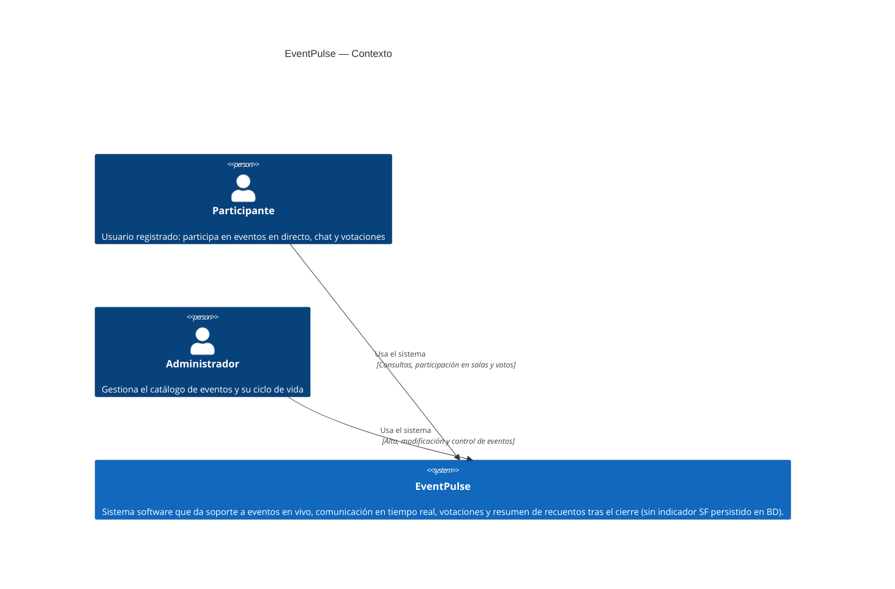
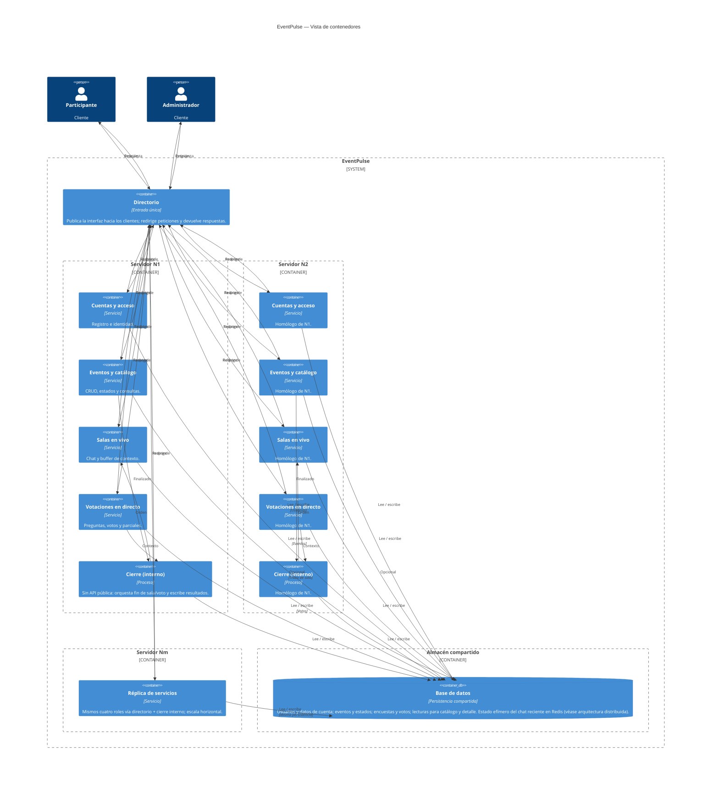

# EventPulse — Propuesta de proyecto

## 1. Descripción general

EventPulse es una plataforma de comunicación en tiempo real que permite a usuarios registrados participar en eventos de la vida real mediante chat en vivo y votaciones mientras el evento está en directo.

Al finalizar el evento, el sistema cierra encuestas y deja de aceptar votos y mensajes de chat acordes al estado; los votos quedan persistidos en base de datos. En el detalle del evento finalizado la interfaz muestra un **recap** (recuentos por encuesta). **No** se persiste un indicador agregado tipo «Social Feeling» ni se expone una API REST pública de catálogo de eventos en la versión actual (véase `event_pulse/README.md` y `doc/arquitectura-distribuida-eventpulse.md`).

El proyecto aprovecha Elixir/OTP: procesos ligeros, tolerancia a fallos por supervisión y modelo adecuado para mensajería concurrente y distribuida bajo carga.

## 2. Actores

| Actor | Rol |
|--------|-----|
| Participante | Usuario registrado: consulta eventos, entra en salas en directo, chatea y vota. |
| Administrador | Gestiona el ciclo de vida y catálogo de eventos (creación, estados, cierre). |

## 3. Requisitos funcionales

Listado alineado con la **implementación vigente** en `event_pulse/`.

### 3.1 Gestión de usuarios

- **RF-01:** El sistema permite registrar usuarios con **nombre de usuario**, **correo electrónico** y **contraseña** (validadas según el esquema de cuenta).
- **RF-02:** El sistema permite **iniciar sesión** y **cerrar sesión** (autenticación por credenciales y sesión en navegador).
- **RF-03:** Las rutas de aplicación principal (listado y detalle de eventos, formularios) exigen usuario autenticado. Las operaciones de **administración** del catálogo (crear/editar/borrar eventos, cambios de estado) están restringidas a usuarios con **rol administrador**.

### 3.2 Gestión de eventos

- **RF-04:** Los administradores pueden **crear**, **actualizar** y **eliminar** eventos desde LiveView, incluyendo campos acordados al modelo (título, descripción, categoría, fechas de inicio y fin, estado).
- **RF-05:** El sistema **lista el catálogo de eventos** y permite **filtrar por categoría** en la interfaz LiveView. Los cambios relevantes del catálogo se **difunden en tiempo real** (p. ej. vía PubSub) a las vistas suscritas.
- **RF-06:** Cada evento se encuentra en uno de los estados **`programado`**, **`en_directo`** o **`finalizado`**, con transiciones controladas (`programado` → `en_directo` → `finalizado`).
- **RF-07:** Los clientes conectados al **detalle del evento** reciben actualizaciones en tiempo real sobre la sala (p. ej. **estado del evento**, **mensajes de chat**, **votaciones y recuentos**) mediante difusión por **tópico de evento** (`event:<id>`).

### 3.3 Votaciones (encuestas)

- **RF-08:** Un evento puede tener **una o más encuestas** (*polls*). Cada encuesta tiene una pregunta y **entre 2 y 4 opciones** de respuesta (texto).
- **RF-09:** Se mantiene **como mucho un voto vigente por participante y encuesta** (en la demo, el participante se distingue con un identificador de sesión acoplado al flujo de voto).
- **RF-10:** Mientras la encuesta y el evento no estén cerrados, el usuario puede **modificar su voto** (sustituye la opción elegida; no acumula votos múltiples).
- **RF-11:** Los **recuentos parciales** se **actualizan y difunden** en tiempo real a los clientes conectados (coordinación con agregación en vivo donde aplique).
- **RF-12:** Al **finalizar** el evento, las encuestas asociadas quedan **cerradas en base de datos** y **no se aceptan votos nuevos ni modificaciones**.

### 3.4 Chat

- **RF-13:** Un usuario autenticado puede **enviar y recibir mensajes** en una **sala de chat asociada al evento** mientras el evento está en directo (difusión en tiempo real).
- **RF-14:** Al **unirse** a la sala, el sistema proporciona un **buffer de mensajes recientes** (orden cronológico), respaldado en **Redis** en despliegues que lo usan, para recuperar contexto reciente.
- **RF-15:** Con el evento en **`finalizado`**, el chat **deja de aceptar** envío de mensajes acorde al estado de la interfaz y al dominio.

### 3.5 Cierre e historial en interfaz

- **RF-16:** Tras el cierre, los **votos por encuesta** permanecen persistidos; el **detalle del evento finalizado** muestra un **resumen de recuentos** por pregunta en LiveView. **No** se calcula ni persiste en esta versión un **indicador agregado tipo «Social Feeling»** en base de datos.

### 3.6 Exposición del sistema

- **RF-17:** El acceso al **catálogo y detalle de eventos**, chat y votaciones se realiza principalmente mediante **interfaz web Phoenix LiveView**. **No** hay en la versión actual **API REST pública documentada** para consumo externo del catálogo de eventos.

## 4. Requisitos no funcionales

Formulación alineada con **lo implementado** en el repositorio (sin prometer SLAs o cargas que el código no mida).

### 4.1 Rendimiento (tiempo real)

- **RNF-01:** La aplicación usa **LiveView** y **PubSub** para difundir chat y recuentos. El diseño persigue **baja latencia percibida**; **no** hay en el proyecto umbrales numéricos obligatorios ni baterías de carga que acoten el rendimiento.

### 4.2 Seguridad

- **RNF-02:** Las rutas principales exigen **usuario autenticado** (sesión y plugs de autorización). Las contraseñas **no** se guardan en claro: en alta/cambio se persiste **`password_hash`** mediante **Pbkdf2** (`hash_pwd_salt`).

### 4.3 Disponibilidad y supervisión OTP

- **RNF-03:** El arranque usa **supervisión OTP** (`one_for_one`) para **reiniciar procesos hijos** ante fallos. Eso **no** equivale a alta disponibilidad total: la caída de **PostgreSQL**, **Redis** o del **nodo BEAM** sigue siendo un fallo de servicio.

### 4.4 Escalabilidad / concurrencia

- **RNF-04:** El stack **Phoenix / OTP** está pensado para crecer en **conexiones concurrentes de forma razonable**. **No** se afirma en el código un techo del tipo «miles de usuarios simultáneos sin degradación» demostrado por pruebas.

### 4.5 Tolerancia a fallos

- **RNF-05:** Un fallo en un **proceso supervisable** puede recuperarse por **reinicio** sin reescribir la aplicación entera; el **alcance** depende de qué proceso falle (p. ej. colapso de `Repo` o del endpoint afecta de forma distinta a un `Task` aislado).

### 4.6 Consistencia de votos

- **RNF-06:** En base de datos se garantiza **como máximo un voto por par** `(user_id, poll_id)` mediante **índice único**. En **varios nodos**, los **recuentos en vivo** difundidos pueden mostrar **desfases breves** entre clientes respecto a la vista persistida.

### 4.7 Mantenibilidad

- **RNF-07:** Código organizado por **contextos** y capa **web**; existen **pruebas automatizadas** bajo `test/` (dominio, votos, LiveView, cuentas, etc.) como apoyo a regresiones, **sin** pretender cobertura exhaustiva.

### 4.8 Observabilidad

- **RNF-08:** Hay **Telemetry** con métricas de Phoenix, Ecto y contadores propios (votos, chat) y **logging** en puntos de dominio (p. ej. errores **best-effort** al vaciar buffer de chat en Redis). En desarrollo puede activarse **LiveDashboard** si `dev_routes` está habilitado.

### 4.9 Escalabilidad horizontal (demo)

- **RNF-09:** El repositorio ofrece **Docker Compose** con **varias réplicas** de la app, **Director (nginx)** para reparto HTTP/WebSocket, **Redis** compartido para el buffer de chat y **libcluster** / `CLUSTER_PEER_HOSTS` para el **clúster Erlang**. El **`VoteAggregator`** está pensado para **una sola réplica** que lo arranque en la demo (`START_VOTE_AGGREGATOR`), coherente con un único agregador global.

## 5. Arquitectura del software (cliente–servidor distribuido y C4)

EventPulse adopta el estilo cliente–servidor distribuido: la aplicación se organiza en servicios independientes que pueden repartirse entre varias máquinas o nodos, de modo que el fallo o la carga de una parte no arrastre necesariamente a todo el sistema. Los clientes son ligeros: solo hacen uso del sistema a través de la interfaz publicada; la lógica de negocio reside en el lado servidor.

Entre clientes y servicios suele interponerse un directorio, el cual publica la forma en que los clientes pueden invocar el sistema y redirige cada petición al servicio que corresponda, recogiendo después la respuesta hacia el cliente. Ese componente intermedio desacopla a los clientes del nodo concreto donde corre cada servicio, a cambio de ser un punto que hay que dimensionar bien para que no limite el rendimiento.

En el interior de cada servidor (N1, N2, …, Nm) conviven uno o más servicios que reciben el trabajo encaminado por el directorio, lo procesan y devuelven el resultado siguiendo el mismo patrón de ida y vuelta a través del directorio. Las responsabilidades de EventPulse se reparten en los servicios nombrados en el diagrama de contenedores.

### 5.1 Vista de contexto

Caja negra del producto frente a los actores: qué aporta EventPulse al participante y al administrador, sin entrar en directorio ni nodos.

### 5.2 Vista de contenedores

Lectura del diagrama: arriba, los clientes y el directorio; en el medio, dos nodos de aplicación típicos (N1 y N2) con los mismos roles; abajo, el nodo de escala Nm y, en un contenedor aparte, la base de datos compartida: el almacén es único para todo el sistema. El servicio de cierre no pasa por el directorio: se dispara al finalizar un evento, y escribe en la base de datos junto al evento.

