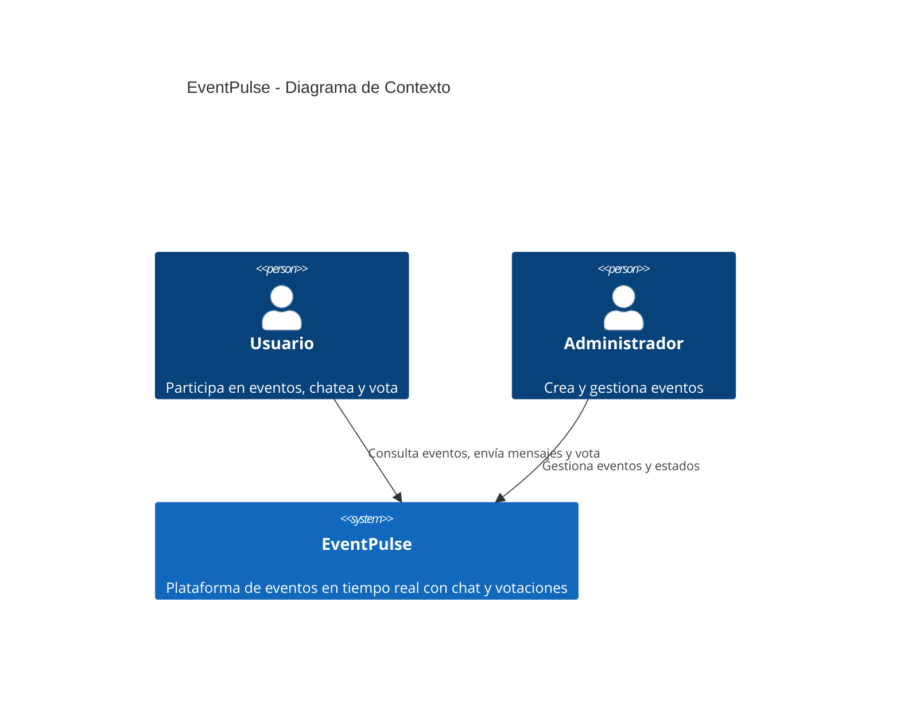
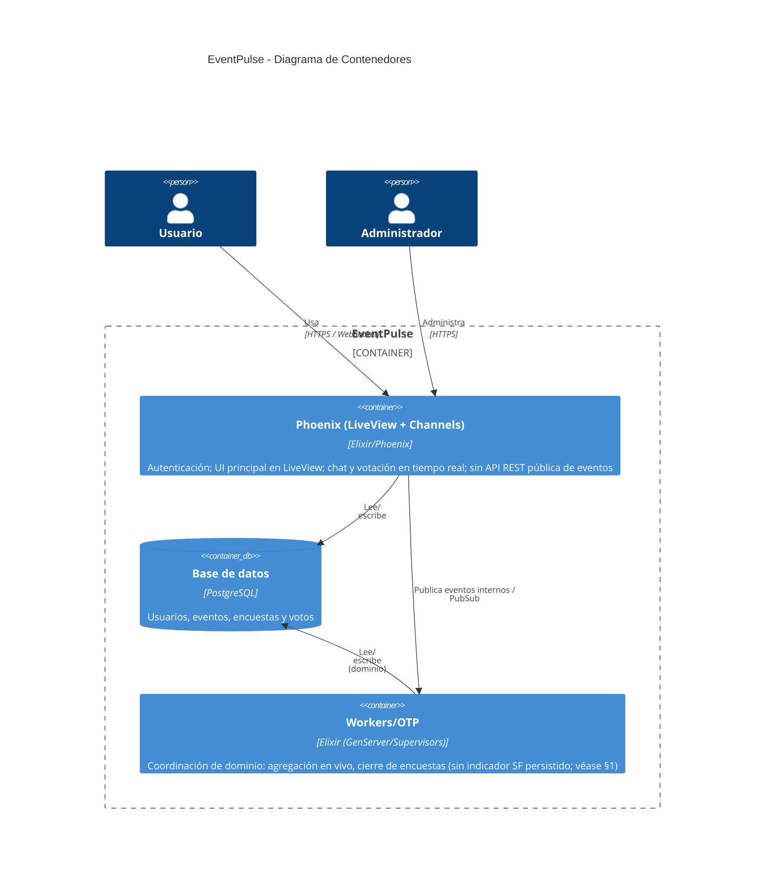

# EventPulse — Propuesta de proyecto

## 1. Descripción general

EventPulse es una plataforma de comunicación en tiempo real que permite a usuarios registrados participar en eventos de la vida real mediante chat en vivo y votaciones mientras el evento está en directo.

Al **finalizar** el evento, el sistema **cierra todas las encuestas** asociadas (no se admiten votos posteriores), **persiste** los votos en base de datos y **vacía de forma best-effort** el buffer de chat del evento en **Redis**. El **detalle del evento finalizado** muestra un **resumen de recuentos** por pregunta (historial de votación). En la **versión actual del código** no se calcula ni persiste un indicador agregado tipo “Social Feeling”; la tabla `social_feeling_results` fue retirada por migración (`RemoveSocialFeeling`). La exposición al usuario es principalmente **LiveView** (navegador autenticado), sin API REST pública de eventos.

El proyecto aprovecha Elixir/OTP: procesos ligeros, tolerancia a fallos por supervisión y modelo adecuado para mensajería concurrente y distribuida bajo carga.

## 2. Actores

| Actor | Rol |
|--------|-----|
| Participante | Usuario registrado: consulta eventos, entra en salas en directo, chatea y vota. |
| Administrador | Gestiona el ciclo de vida y catálogo de eventos (creación, estados, cierre). |

## 3. Requisitos funcionales

### 3.1 Gestión de usuarios

| ID | Requisito |
|----|-----------|
| RF-01 | El sistema deberá permitir el registro de usuarios con nombre de usuario, correo electrónico y contraseña válidos. |
| RF-02 | El sistema deberá autenticar usuarios mediante credenciales. |

### 3.2 Gestión de eventos

| ID | Requisito |
|----|-----------|
| RF-03 | El sistema deberá permitir a los administradores crear eventos con al menos: nombre, descripción, categoría, fecha/hora de inicio y fecha/hora estimada de fin; asimismo deberá permitir consultar, actualizar y eliminar eventos. |
| RF-04 | Cada evento deberá encontrarse en uno de los estados: programado, en directo o finalizado. |
| RF-05 | El sistema deberá listar eventos en directo y permitir filtrado o búsqueda por categoría según el modelo de datos acordado. |

### 3.3 Chat en tiempo real

| ID | Requisito |
|----|-----------|
| RF-06 | Un usuario autenticado deberá poder unirse a la sala de chat de un evento en directo (y abandonarla de forma ordenada). |
| RF-07 | Los mensajes enviados por un usuario deberán difundirse en tiempo real a todos los participantes conectados a la misma sala. |
| RF-08 | El sistema deberá mantener un buffer de los últimos N mensajes de la sala (orden cronológico) y, al unirse un participante o reconectarse, enviarle esos mensajes para que recupere el contexto reciente de la conversación. |

### 3.4 Votaciones

| ID | Requisito |
|----|-----------|
| RF-09 | Cada evento deberá poder tener una o más preguntas de votación asociadas. |
| RF-10 | Un usuario deberá poder emitir o modificar su voto mientras la votación o el evento no hayan terminado. |
| RF-11 | Los resultados parciales deberán actualizarse y difundirse a los participantes en tiempo razonablemente cercano al real. |

### 3.5 Cierre e historial de votaciones

| ID | Requisito |
|----|-----------|
| RF-12 | Al finalizar el evento, todas las encuestas asociadas pasan a estado cerrado y no se aceptan votos nuevos ni modificaciones. |
| RF-13 | Tras el cierre, el sistema elimina de forma **best-effort** el buffer de chat del evento en Redis (no revierte el cierre en base de datos si Redis falla). |
| RF-14 | Los votos por encuesta quedan persistidos en base de datos; el detalle del evento **finalizado** muestra el resumen de resultados por pregunta en la interfaz LiveView. |

## 4. Requisitos no funcionales

| ID | Atributo de calidad | Requisito |
|----|---------------------|-----------|
| RNF-01 | Escalabilidad / concurrencia | El diseño deberá permitir crecer en número de conexiones concurrentes de forma razonable. |
| RNF-02 | Rendimiento (chat) | El chat deberá sentirse fluido: la propagación de mensajes a los participantes de una sala será un objetivo de baja latencia. |
| RNF-03 | Disponibilidad | El diseño deberá favorecer la continuidad del servicio (réplicas, supervisión OTP, recuperación ante fallos de proceso). |
| RNF-04 | Tolerancia a fallos | Se buscará que el fallo de una sala o proceso aislable tenga impacto acotado en el resto del sistema y que los supervisores OTP permitan recuperación automática o manual. |
| RNF-05 | Consistencia de votos | A efectos de cierre del evento, deberá garantizarse un solo voto vigente por usuario y pregunta; los recuentos en vivo en un despliegue multi‑nodo podrán mostrar pequeños desfases breves entre clientes. |
| RNF-06 | Escalabilidad horizontal | La arquitectura deberá contemplar varios nodos de aplicación y el reparto de carga a alto nivel. |
| RNF-07 | Seguridad | Las contraseñas no se almacenan en claro; se usa **PBKDF2** (dependencia `pbkdf2_elixir`) con hash almacenado de forma segura. |
| RNF-08 | Observabilidad | Se plantea usar Telemetry y logging en los puntos útiles para depurar. |
| RNF-09 | Mantenibilidad y calidad del desarrollo | El código deberá ser legible y coherente y las pruebas automatizadas cubrirán las partes que el equipo considere prioritarias. |

## 5. Arquitectura del software (cliente–servidor distribuido y C4)

EventPulse adopta el estilo cliente–servidor distribuido: la aplicación se organiza en servicios independientes que pueden repartirse entre varias máquinas o nodos, de modo que el fallo o la carga de una parte no arrastre necesariamente a todo el sistema. Los clientes son ligeros: solo hacen uso del sistema a través de la interfaz publicada; la lógica de negocio reside en el lado servidor.

Entre clientes y servicios suele interponerse un directorio, el cual publica la forma en que los clientes pueden invocar el sistema y redirige cada petición al servicio que corresponda, recogiendo después la respuesta hacia el cliente. Ese componente intermedio desacopla a los clientes del nodo concreto donde corre cada servicio, a cambio de ser un punto que hay que dimensionar bien para que no limite el rendimiento.

En el interior de cada servidor (N1, N2, …, Nm) conviven uno o más servicios que reciben el trabajo encaminado por el directorio, lo procesan y devuelven el resultado siguiendo el mismo patrón de ida y vuelta a través del directorio. Las responsabilidades de EventPulse se reparten en los servicios nombrados en el diagrama de contenedores.

### 5.1 Vista de contexto

Caja negra del producto frente a los actores: qué aporta EventPulse al participante y al administrador, sin entrar en directorio ni nodos.

### 5.2 Vista de contenedores

Vista **lógica** de contenedores (un solo límite `EventPulse`): interfaz Phoenix (HTTP/WebSocket), persistencia PostgreSQL y procesos OTP. En despliegue distribuido pueden existir réplicas y Redis para el buffer de chat; este diagrama los abstrae. *Nota:* la superficie hacia el navegador es **LiveView** y rutas de **autenticación** por HTTP; **Channels** cubren el tiempo real; en la **versión actual** **no** hay **API REST pública** para eventos ni salas (no se expone un backend HTTP REST consumible como catálogo externo). El bloque del diagrama refleja ese stack Phoenix unificado, no un desglose “API + SPA”.

