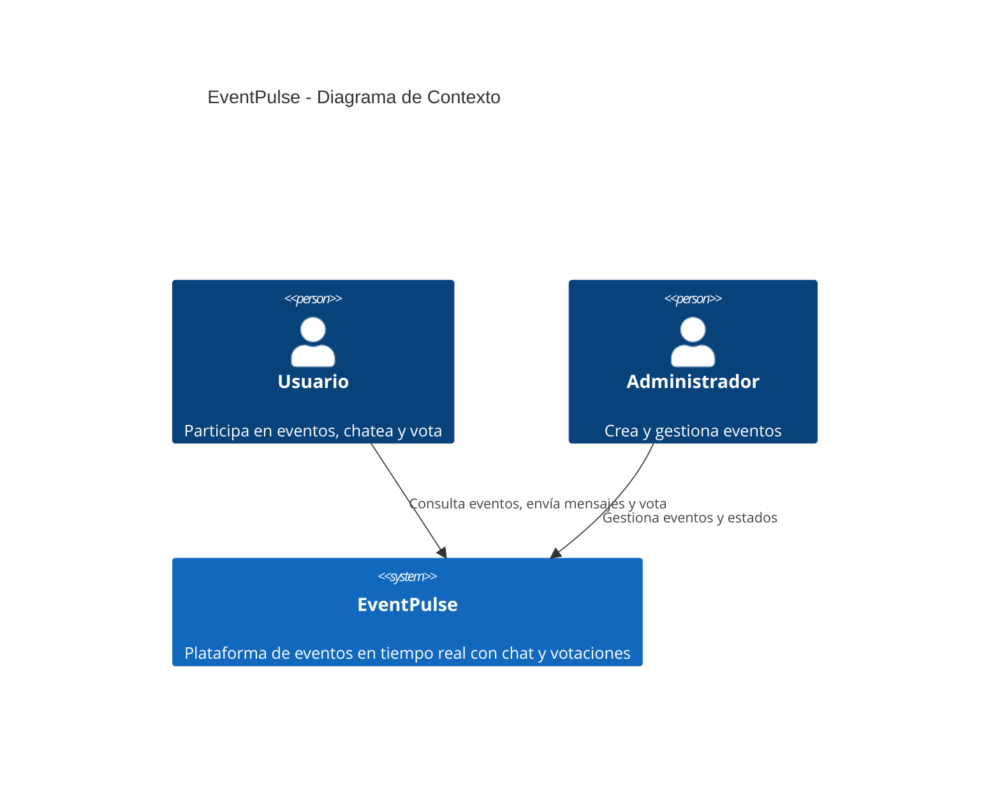
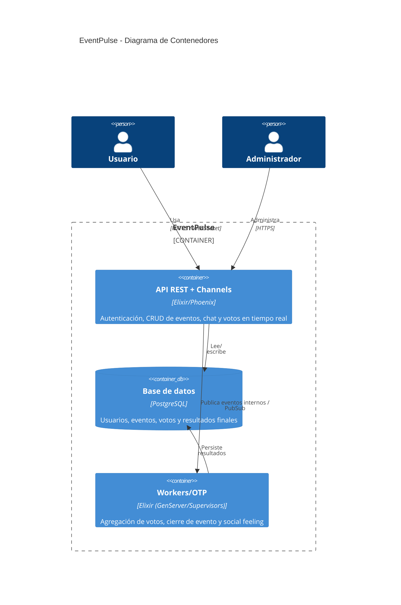

# Definición del Proyecto

El objetivo no es hacer una aplicación con mil funciones, sino una
aplicación bien diseñada arquitectónicamente.

- El Qué (Funcional): ¿Qué hace la app? (Ej: Un sistema de chat, un
  gestor de sensores).

  EventPulse es una plataforma de comunicación en tiempo real que permite a sus usuarios participar activamente en eventos de la vida real mediante dos mecanismos principales: chat en vivo y votaciones. Durante la transmisión de un evento (deportivo, cultural, político, etc.), los usuarios registrados pueden unirse a la sala del evento, intercambiar mensajes con otros participantes y emitir votos sobre aspectos concretos del evento.
Una vez que el evento finaliza, el sistema agrega todas las votaciones recogidas y calcula el Social Feeling, un indicador cuantitativo y cualitativo que resume la percepción colectiva de los participantes sobre dicho evento. Este indicador junto con las votaciones, quedan almacenados permanentemente como parte del historial del evento.

- El Cómo (No Funcional): Aquí está el corazón de la asignatura. ¿Debe
  ser rápido? ¿Debe seguir funcionando si un nodo cae
  (disponibilidad)? ¿Cómo se protege la información (seguridad)?

- La Estrategia (Arquitectura): Debéis elegir una arquitectura
  distribuida (Client-Server, Peer-to-Peer, Microservicios, etc.) y
  aplicar tácticas (redundancia, balanceo de carga,
  latidos/heartbeats) para cumplir esos requisitos no funcionales.

- El Boceto: Presentad un diagrama C4 inicial (Nivel 1 y 2). No tiene
  que ser perfecto, pero sí mostrar la intención.

